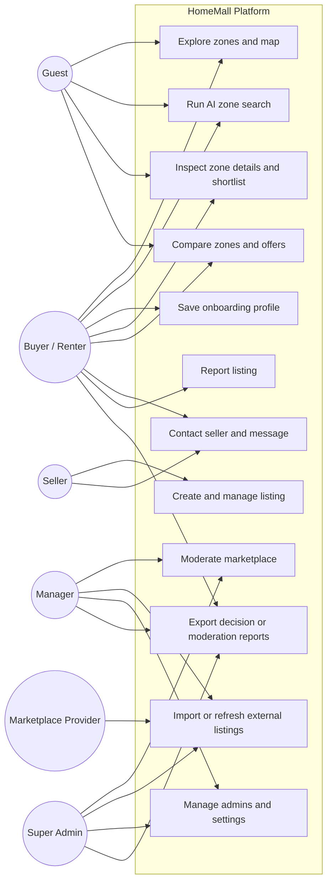

# HomeMall Use Cases

This document translates the current HomeMall codebase into a practical use-case view. It is based on the implemented web and API flows in `apps/web` and `apps/api`, not only on the planned specification.

## 1. Actors

| Actor | Description | Current access surface |
| --- | --- | --- |
| Guest visitor | Unauthenticated visitor exploring zones before signup | Web zones explorer, AI search, compare, zone details |
| Buyer / renter user | Authenticated end user looking for a place to live or invest | Web onboarding, zones, compare, messaging, reports |
| Seller user | Authenticated end user publishing and managing listings | Web listings workspace, messaging |
| Manager | Admin operator with scoped permissions | Backoffice dashboard, listings, reports, imports, settings, zones |
| Super admin | Highest-privilege admin with governance rights | All manager flows plus admin account management |
| External marketplace provider | Avito, Mubawab, or generic import source | Admin import and refresh workflows |

## 2. System Use-Case View

## 3. Catalog

| ID | Use case | Primary actor | Goal | Main web entry points | Main API touchpoints | Status |
| --- | --- | --- | --- | --- | --- | --- |
| UC-01 | Explore zones and map | Guest, User | Discover candidate zones with filters, scores, and map context | `/zones`, `/app/zones` | `GET /api/zones`, `POST /api/analyze/zones` | Implemented |
| UC-02 | Run AI zone search | Guest, User | Turn a natural-language housing query into ranked zone matches | `/zones`, Copilot drawer | `POST /api/search/ai`, `POST /api/copilot/chat` | Implemented |
| UC-03 | Save onboarding profile | User | Persist goal, budget, mobility, and sensitivities for personalized analysis | `/onboarding`, `/app/onboarding` | `GET /api/profile`, `POST /api/profile/save` | Implemented |
| UC-04 | Inspect zone details and shortlist | Guest, User | Understand score, TCL, future outlook, offers, and save a zone candidate | `/zones/[zoneId]`, `/app/zones/[zoneId]` | `GET /api/zones/:id`, `GET /api/listings`, `POST /api/favorites` | Implemented |
| UC-05 | Compare zones and offers | Guest, User | Evaluate two to six options and identify the strongest fit | `/compare`, `/app/compare` | `POST /api/analyze/compare`, `GET /api/profile`, `GET /api/zones` | Implemented |
| UC-06 | Create and manage listing | Seller | Publish a property, upload media, and update status/details | `/listings` | `GET /api/listings/mine`, `POST /api/listings/upload`, `POST /api/listings`, `PATCH /api/listings/:id`, `DELETE /api/listings/:id` | Implemented |
| UC-07 | Contact seller and message | User, Seller | Create a conversation around a listing and exchange messages | Zone details, `/messages` | `POST /api/listings/:id/contact`, `GET /api/chats`, `GET /api/chats/:conversationId/messages`, `POST /api/chats/:conversationId/messages` | Implemented |
| UC-08 | Report listing | User | Flag abusive or suspicious content to admins | Zone details, messages workspace | `POST /api/listings/:id/report` | Implemented |
| UC-09 | Moderate marketplace | Manager, Super admin | Review listings, users, reports, zones, and metrics | `/admin/dashboard`, `/admin/listings`, `/admin/reports`, `/admin/users`, `/admin/zones`, `/admin/metrics` | `GET /api/admin/dashboard`, `GET/PATCH/DELETE /api/admin/*` | Implemented |
| UC-10 | Import or refresh external listings | Manager, Super admin | Bring external marketplace inventory into HomeMall | `/admin/import` | `POST /api/admin/import`, `POST /api/admin/import/refresh` | Implemented |
| UC-11 | Manage admins and settings | Super admin, Manager | Govern admin accounts and system configuration | `/admin/admins`, `/admin/settings` | `GET/POST/PATCH /api/admin/admins`, `GET/PUT /api/admin/settings/:key` | Implemented |
| UC-12 | Export decision or moderation reports | User, Manager, Super admin | Retrieve user decision reports or admin report exports | API-first, `/admin/reports` | `GET /api/report`, `GET /api/report/pdf`, `GET /api/admin/reports/export` | Implemented |

## 4. Detailed Use Cases

### UC-01 Explore zones and map

- Primary actors: Guest visitor, buyer/renter user
- Goal: Browse available zones with explainable scores, filters, and live listing counts
- Preconditions: Zone and metric data exist in the database
- Trigger: Actor opens `/zones`
- Main flow:
  1. The web app loads the zone catalog from `GET /api/zones`.
  2. The explorer shows list and map views, score badges, and listing inventory.
  3. Filter changes build a temporary profile and call `POST /api/analyze/zones`.
  4. The actor selects a zone from the list or map.
- Alternate flows:
  1. If personalized analysis fails, baseline zone scores remain visible.
  2. If the actor is unauthenticated, exploration still works in guest mode.
- Success outcome: The actor has a ranked shortlist of candidate zones

### UC-02 Run AI zone search

- Primary actors: Guest visitor, buyer/renter user
- Goal: Express housing intent in natural language and receive ranked zone recommendations
- Preconditions: Zone metrics are available; query text is at least two characters
- Trigger: Actor submits a free-text query in the zones explorer or copilot
- Main flow:
  1. The UI sends the query and current constraints to `POST /api/search/ai`.
  2. The backend parses constraints such as city, goal, budget, quiet/safe preferences, and result limit.
  3. The AI search use case computes zone score, TCL, future outlook, and short reasons.
  4. The UI renders ranked results and assumptions.
- Alternate flows:
  1. If the query is too short, the UI blocks submission.
  2. If search fails, the explorer remains usable with normal filtering.
- Success outcome: The actor sees an explainable ranked result set tied to the request

### UC-03 Save onboarding profile

- Primary actor: Authenticated user
- Goal: Save preference data used by downstream analysis and compare flows
- Preconditions: User is logged in
- Trigger: User completes the onboarding wizard
- Main flow:
  1. The wizard collects goal, budget, work coordinates, mobility modes, and sensitivities.
  2. Existing profile data is loaded from `GET /api/profile` when available.
  3. The final step saves the profile through `POST /api/profile/save`.
  4. The user is redirected back to zones with personalized analysis available.
- Alternate flows:
  1. If the user is not logged in, the UI redirects to login and preserves the return path.
  2. A local draft is retained until save succeeds.
- Success outcome: Personalized profile data is persisted for the user

### UC-04 Inspect zone details and shortlist

- Primary actors: Guest visitor, buyer/renter user
- Goal: Understand a zone deeply and decide whether to save it or act on live offers
- Preconditions: The selected zone exists
- Trigger: Actor opens `/zones/[zoneId]`
- Main flow:
  1. The page displays score breakdown, risk indicators, TCL estimate, future outlook, and related zones.
  2. The page loads live offers for the selected zone from `GET /api/listings`.
  3. The actor can open Google Maps, compare the zone, or inspect seller profiles.
  4. If authenticated, the actor can save the zone as a report candidate through `POST /api/favorites`.
- Alternate flows:
  1. Unauthenticated users can read the zone details but are redirected to login for protected actions.
  2. If no offers exist, the page still presents zone-level analysis.
- Success outcome: The actor either shortlists the zone or moves to compare/contact actions

### UC-05 Compare zones and offers

- Primary actors: Guest visitor, buyer/renter user
- Goal: Compare multiple options on score, TCL, and future outlook
- Preconditions: At least two candidate options are available
- Trigger: Actor opens `/compare` directly or adds offers from zone details
- Main flow:
  1. The compare page loads zones and optionally the saved profile.
  2. The actor compares two to six options sourced from selected zones or compare-cart offers.
  3. The UI sends pairwise requests to `POST /api/analyze/compare`.
  4. The page ranks options using wins, utility, and TCL tie-breaks.
- Alternate flows:
  1. Guests can compare with generated defaults even without a saved profile.
  2. Listing-linked compare options deep-link back to listing details.
- Success outcome: The actor receives a winner and a transparent ranking table

### UC-06 Create and manage listing

- Primary actor: Seller user
- Goal: Publish and maintain property inventory in the marketplace
- Preconditions: Seller is logged in; target zone is known or can be drafted from place search
- Trigger: Seller opens `/listings`
- Main flow:
  1. The workspace loads the seller's current listings from `GET /api/listings/mine`.
  2. The seller enters property details, pricing, contact channels, and media files.
  3. Media uploads are sent to `POST /api/listings/upload`.
  4. Listing metadata is created with `POST /api/listings`.
  5. Existing listings can be edited, paused, activated, closed, or deleted.
- Alternate flows:
  1. If the seller is not logged in, the route redirects to login.
  2. New location suggestions can come from Google Places or a fallback Morocco city list.
- Success outcome: The seller has an active and manageable listing portfolio

### UC-07 Contact seller and message

- Primary actors: Buyer/renter user, seller user
- Goal: Start and continue a conversation about a listing
- Preconditions: Buyer is logged in; a listing exists
- Trigger: Buyer clicks `Contact seller` on an offer
- Main flow:
  1. The UI posts an initial message to `POST /api/listings/:id/contact`.
  2. The backend creates or reuses a conversation keyed by listing and buyer.
  3. The user is redirected to `/messages`.
  4. Both participants can load threads and send additional messages through `/api/chats/*`.
- Alternate flows:
  1. If the buyer is not logged in, the UI redirects to login with a return path.
  2. If messaging fails, the actor remains on the current page with feedback.
- Success outcome: A persistent buyer-seller conversation exists for the listing

### UC-08 Report listing

- Primary actor: Authenticated user
- Goal: Escalate abusive, fraudulent, or low-quality listings to the admin team
- Preconditions: User is logged in and provides a reason
- Trigger: User selects `Report offer`
- Main flow:
  1. The UI asks the user for a report reason.
  2. The request is sent to `POST /api/listings/:id/report`.
  3. Admin users later review the report in the backoffice report area.
- Alternate flows:
  1. Duplicate reports from the same user for the same listing are prevented by persistence rules.
  2. If the user cancels the prompt, no report is submitted.
- Success outcome: The listing report is stored for moderation

### UC-09 Moderate marketplace

- Primary actors: Manager, super admin
- Goal: Keep users, listings, reports, zones, and metrics in a trusted state
- Preconditions: Admin is authenticated and has the required permission
- Trigger: Admin enters the backoffice
- Main flow:
  1. Dashboard KPIs are loaded from `GET /api/admin/dashboard`.
  2. Admin screens retrieve users, listings, reports, zones, metrics, and settings from `/api/admin/*`.
  3. Admin actions update status, remove content, or edit configuration.
  4. RBAC middleware enforces role and permission checks server-side.
- Alternate flows:
  1. Unauthorized admins are blocked per permission-specific route guards.
  2. Super admin-only operations, such as admin account management, are further restricted by role.
- Success outcome: Marketplace data and operations are moderated within policy

### UC-10 Import or refresh external listings

- Primary actors: Manager, super admin, external marketplace provider
- Goal: Keep inventory fresh using external feeds and refresh jobs
- Preconditions: Admin has `MANAGE_IMPORTS`
- Trigger: Admin opens `/admin/import` and submits an import or refresh action
- Main flow:
  1. The admin submits Avito, Mubawab, or generic source data.
  2. The backend normalizes source fields into the HomeMall listing model.
  3. Imports are processed through `POST /api/admin/import` or `POST /api/admin/import/refresh`.
  4. External listings coexist with manual listings using source metadata and dedupe rules.
- Alternate flows:
  1. Provider outages or malformed rows return validation or processing errors.
  2. Refresh jobs can be rerun without changing manual seller listings.
- Success outcome: External inventory is inserted or updated with provenance preserved

### UC-11 Manage admins and settings

- Primary actors: Super admin, manager
- Goal: Govern operational access and key platform configuration
- Preconditions: Admin is authenticated; action matches permission or role policy
- Trigger: Admin opens `/admin/admins` or `/admin/settings`
- Main flow:
  1. System settings are listed and upserted through `/api/admin/settings`.
  2. Super admins create and update admin accounts through `/api/admin/admins`.
  3. Permissions determine which backoffice areas each admin may access.
- Alternate flows:
  1. Managers may manage settings only when granted `MANAGE_SETTINGS`.
  2. Managers cannot create or edit admin accounts because those routes require `SUPER_ADMIN`.
- Success outcome: Operational governance matches the RBAC policy

### UC-12 Export decision or moderation reports

- Primary actors: Authenticated user, manager, super admin
- Goal: Retrieve report artifacts for user decision support or admin moderation work
- Preconditions: Actor is authenticated and authorized for the requested report type
- Trigger: Actor calls the report endpoint or admin export
- Main flow:
  1. User decision reports are available from `GET /api/report` and `GET /api/report/pdf`.
  2. Admin moderation exports are available from `GET /api/admin/reports/export`.
  3. Consumers download or process the returned artifact.
- Alternate flows:
  1. The current web route `/report` redirects to `/admin/reports`, so user report consumption is API-first at the moment.
- Success outcome: The requested report artifact is generated or exported successfully

## 5. Traceability to Functional Requirements

| Use case | Main specification links |
| --- | --- |
| UC-01 | FR-004 Zones Explorer |
| UC-02 | FR-006 Analysis, FR-022 API Docs |
| UC-03 | FR-001 Authentication, FR-003 Onboarding/Profile |
| UC-04 | FR-005 Zone Details, FR-010 Favorites |
| UC-05 | FR-006 Analysis, FR-007 Compare Workspace |
| UC-06 | FR-008 Listings (User) |
| UC-07 | FR-009 Listings (Public), FR-011 Messaging |
| UC-08 | FR-012 Listing Reports |
| UC-09 | FR-014 Admin Dashboard, FR-015 Admin Users, FR-016 Admin Listings, FR-018 Admin Reports, FR-020 Admin Settings |
| UC-10 | FR-019 Admin Import, FR-021 External Ingestion, FR-DATA-01 to FR-DATA-06 |
| UC-11 | FR-002 RBAC, FR-017 Admin Admins, FR-020 Admin Settings |
| UC-12 | FR-013 Decision Report, FR-018 Admin Reports |

## 6. Notes

- `Favorites` currently behave as saved zone report candidates through `/api/favorites`.
- Offer likes and compare-cart state in the web app are handled client-side for quick interaction, while seller contact and reporting are persisted server-side.
- The backoffice permission model is enforced in Express middleware, not only in the UI.
